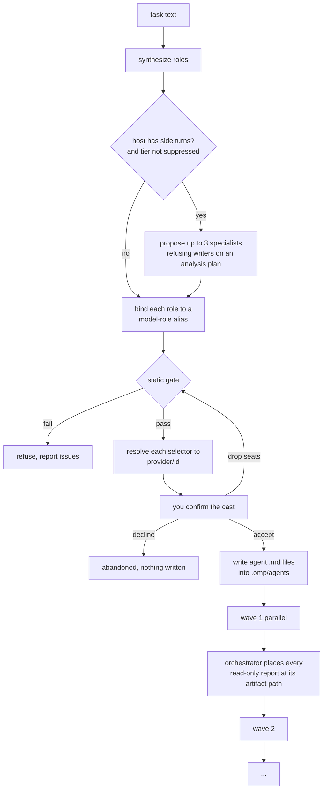

# omp-role-fleet

**One task in. A team of specialised agents out.** Give oh-my-pi a piece of work
and this plugin decides who should do what, gives each of them their own model,
runs them in waves, and hands the result back to the main model.

<https://github.com/supa-magic/omp-role-fleet>

```
you:   refactor the auth module across several files and review it
plugin: scout → planner → implementer → tester → reviewer
        each one runs on the model that suits it, in dependency order
```

No config file, no roster to maintain, no `agents/*.md` to hand-write. The
plugin writes those agent definitions for you, per run, and prunes the previous
run's on the next one.

---

## Install

```sh
omp plugin install @supa-magic/omp-role-fleet
```

Then **start a new session**. Extension modules load at session start and
`/reload-plugins` does not rebuild them, so a running session never picks up
freshly installed plugin code. Check that it took with:

```sh
omp plugin list          # is it enabled?
/role-fleet --version    # which version is loaded?
```

Working from a checkout instead? Link it — a local path is symlinked, not
copied, so your edits are live:

```sh
omp plugin link ./omp-role-fleet
```

**Requires:** oh-my-pi 18.10 or newer. The plugin ships as TypeScript and the
host loads it as-is — no build step, no runtime dependencies. Node 22.6+ is
only needed to run the test suite from a checkout.

---

## Your first run

Try it on something harmless first, with `--dry-run`, which plans without
writing anything:

```text
/role-fleet refactor the auth module across several files and review it --dry-run
```

You get back a plan — who would work on it, in which wave, on which model — and
nothing is written to disk. Drop `--dry-run` when the plan looks right.

From then on it is one command:

```text
/role-fleet fix the login bug
```

The roles run as real background agents. Press `Alt+A` for the Agent Hub to watch
them: each agent shows its resolved model, status, and token usage as it works.

---

## Flags

| Flag | What it does |
|---|---|
| `--dry-run`, `-n` | Plan only. Writes nothing. |
| `--council [N]` | Replace the single reviewer with N reviewers on different models (max 3). |
| `--models (a,b,c)` | Run the review seats on exactly these models, in this order (max 5). |
| `--consul MODEL` | Model that reconciles the council's reports. Default: your session model. |
| `--review-only` | Scout and review seats only. No seat can edit the code. |
| `--max-roles N` | Cap on generated roles (default 4, hard max 8). |
| `--allowlist FILE` | Pin models to a file instead of using `@` aliases. A leading `~` is expanded. |

A value past a flag's ceiling is clamped to it, never dropped, and the clamp is
reported in the plan's notes rather than applied silently. A non-numeric value is
refused the same way, and the word stays in the task text instead of being
swallowed as a bogus number.

Two of these are worth explaining, because they change the rules rather than the
details.

**`--allowlist FILE`** — by default each role takes a *model-role alias*
(`@smol`, `@plan`, `@task`, `@slow`, `@vision`), and which concrete model stands
behind `@slow` is decided by your `modelRoles` in `/model`. An allowlist replaces
that indirection with an explicit list. Reach for it when you have a compliance
requirement, when one specific model is clearly better for a class of work, or
when you want to pin the fleet once and not think about it again:

```json
{
  "models": [
    { "selector": "anthropic/claude-haiku-4-5", "aliases": ["haiku"] },
    { "selector": "anthropic/claude-sonnet-4-6", "aliases": ["sonnet"] }
  ],
  "roles": [
    { "role": "scout", "chain": ["haiku"] },
    { "role": "implementer", "chain": ["sonnet"] }
  ]
}
```

That is the whole schema. `models` name concrete selectors (add `"enabled": false`
to bench one); `roles` name a seat and the chain of models it may take, in
preference order. Binding is **ordinal per seat**: the second reviewer in a
council takes the second model in that seat's chain, not the first — otherwise
"review with different providers" would quietly become three copies of one model.

A seat the file describes is pinned. A seat it does not describe keeps its `@`
alias and the plan records a note saying so — the file constrains the seats it
lists, it is not a blanket guarantee that no unlisted model can run.

Set it once instead of passing the flag every time:

```sh
export ROLE_FLEET_ALLOWLIST=~/my-fleet.json
```

**`--models (a,b,c)`** — when you know exactly which models should do the
reviewing, name them instead of choosing a size:

```text
/role-fleet --models (xai/grok-4, zai/glm-5, anthropic/claude-opus-4-6) refactor the auth module
```

One reviewer per model, in the order you wrote them. Flags may come in any
order and the task text may sit anywhere — putting it last is usually easiest to
read, and nothing depends on it being first. Aliases work too
(`--models (@slow,@task,@plan)`), as does a bare model id (`(glm-5)`) and a
single model without commas.

The brackets are what make it safe. Without them, telling a bare list from the
first word of the task is a guess, and the expensive guess is
`--models fix the login bug` → reviewers on a model called `fix`, with the
task's first word gone. The brackets say where the list ends, so nothing is
guessed and nothing is eaten.

The size is the list length, so a two-model list runs two reviewers and never
the default three: padding it would spend runs you did not ask for on models you
did not name. A single model retargets the reviewer the plan already has instead
of duplicating the review, and a list longer than a `--council N` grows the
council instead of dropping names. Whatever the plan could not honour is
reported in its notes — a member past the end of your list, an analysis-only
task with no reviewer to retarget, a duplicate name, a cap. Duplicates collapse,
because two members on one model is the double-priced single review this flag
exists to avoid.

If an allowlist is in play it still wins for the seats it describes, and the
plan says so.

**`--review-only`** — scout and the review seats, nothing else: no implementer,
no tester, no write-capable specialist, and no proposed roles either. Most tasks
do not need the flag, because asking for a council, naming the review models, or
appointing a consul already means "review this", and the plugin reads that from
the parameters rather than from the prose. The flag is for the case words cannot
separate:

```text
/role-fleet --review-only review the auth fix
```

Here "fix" reads as a change verb, so a plain `--council` would add an
implementer. The flag says the intent once, instead of leaving it to a keyword.
Any seat you remove at the confirmation screen takes its dependents with it — you
cannot leave a tester waiting on an implementer that is not running.

---

## Confirming the cast

Every seat is a paid run, so nothing is written and nothing is dispatched until
you have seen the cast. The cast is proposed by rule — same task, same flags,
same seats, every time — and you confirm it:

```text
Run 7 seat(s) on @smol, @plan, @task, xai-oauth/grok-4.5, zai/glm-5.3, minimax-code/MiniMax-M3.1?
1 seat(s) can edit code, 4 hold repo-wide write and could overwrite any path.

○ Run all of them  (Recommended)
    All seats, exactly as planned.
      Investigator — maps where the task touches, with file:line evidence
        (@smol — unresolved) — read-only
      Planner — turns the investigation into a locked implementation plan
        (@plan — unresolved) — read-only
      Implementer — implements the plan with the smallest correct change
        (@task — unresolved) — can change the code
      Reviewer 1 — reviews the change for correctness, scope, and evidence
        (xai-oauth/grok-4.5) — holds repo-wide write — can create or overwrite any path
      Reviewer 2 — reviews the change for correctness, scope, and evidence
        (zai/glm-5.3) — holds repo-wide write — can create or overwrite any path
      Reviewer 3 — reviews the change for correctness, scope, and evidence
        (minimax-code/MiniMax-M3.1) — holds repo-wide write — can create or overwrite any path
      Consul — reconciles the council's reports into one verdict (zai/glm-5.3)
        — holds repo-wide write — can create or overwrite any path
○ Look, don't touch
    Drops Implementer — no seat can edit code, and nothing here can write at all.
    Reviewer 1, Reviewer 2, Reviewer 3, Consul go too: nothing left for them to do.
      Investigator — … — read-only
      Planner — … — read-only
○ One reviewer instead of three
    One opinion instead of three — a third of the review cost. Drops Reviewer 2,
    Reviewer 3. Consul goes too: nothing left for it to do.
○ Choose each seat yourself
    Opens a checklist: every seat, what it does, which model it runs on, what it can write
```

**Run all of them** is the recommended option, so accepting is one Enter. The
other presets are offered only when they would change something — a list with two
identical options is worse than a shorter list.

The roster sits in each option's **preview** block, one seat per line, while the
description says only what the choice changes. That split is forced by the host:
an option description is rendered as one inline paragraph and its line breaks are
folded away, so a description carrying five seats becomes a single run-on
sentence. The preview is the field that keeps its lines.

Each seat says what it does, the model it runs on, and the authority it holds,
because a seat id tells you neither the provider — `@slow` and `@task` say what
class of work a seat is for, not who answers — nor the grant. Three authorities are
distinguished, because they are three different risks:

| Grant | The screen says |
|---|---|
| `edit` | *can change the code* |
| `write` without `edit` | *holds repo-wide write — can create or overwrite any path* |
| neither | *read-only* |

The middle row is not a cosmetic distinction. A council member gains `write` when a
consul is appointed, so its report reaches the filesystem for the deciding seat to
read; the seat's own brief calls that "writes its own report", and nothing in the
grant scopes it to that path. Naming the purpose as if it were the boundary would
make the consent screen understate what the run may touch, so the grant is named,
and the cast question says how many seats hold it.

**Look, don't touch** drops the seats that can change the code and keeps the ones
that cannot. A council member that writes its own report for the consul to read is
*kept*: dropping it would leave the review with nobody doing it. It is kept under its
real grant, and the choice names the repo-wide writers that remain — the option
removes the editors, not every writer.

**Choose each seat yourself** opens one row per seat with the same three facts,
plus the wave it lands in. Removing a seat takes its dependents with it: you
cannot leave a tester waiting on an implementer that is not running, because a
plan with a dangling edge is refused as a whole. Whatever you drop is recorded
in the plan's notes, so the dispatch record says what actually ran.

**This screen is interactive-only.** `askDialog` does not exist in print or RPC
mode, so those hosts dispatch straight through — which is what the flags are for.
`--dry-run` shows the same cast without asking, for when you would rather read
than answer.

**While it plans, the status line animates.** Choosing the cast can include a
model call for extra roles, and a command that goes quiet for several seconds
looks exactly like a dropped keypress. The run puts a braille spinner and
`role-fleet: choosing the cast…` on the status bar — the same spinner omp draws
itself — and clears it before the dialog opens, since a spinner ticking underneath
a menu reads as a hung process. It is cleared on the way out too, including when
the run throws.

The screen is built from the **resolved** models, not the aliases: `@slow`
describes the class of work, and the dialog exists to tell you who answers. If an
alias cannot be resolved the row says so rather than presenting the alias as a
provider.

One thing the host does not offer: a proposal cannot be pre-checked. A multi
question's initial selection is always empty and `recommended` only sets the
cursor, so the proposed set is shown on the preset screen instead of as ticks in
the checklist.

---

## Which model actually runs

Every role is pinned to a *model-role alias* (`@slow`, `@task`, …), and the
alias only says which **class** of work the seat is for — not which model
answered. `@slow` points somewhere different on every account, a provider can go
down mid-run, and `/model` can be edited between two waves.

So the plugin resolves each selector through the host (`ctx.models.resolve`)
and shows you both:

```text
Wave 2 (parallel x3):
  • reviewer-c1 anthropic/claude-opus-4-6 (@slow) ← planner
  • reviewer-c2 xai/grok-4 (@task)
  • reviewer-c3 zai/glm-5 (@plan)

Models in this run (roster id → role → model):
- `ReviewerC1 ClaudeOpus46` — reviewer-c1 on `anthropic/claude-opus-4-6` (pinned as `@slow`)
- `ReviewerC2 Grok4` — reviewer-c2 on `xai/grok-4` (pinned as `@task`)
- `ReviewerC3 Glm5` — reviewer-c3 on `zai/glm-5` (pinned as `@plan`)
```

The alias stays pinned in the agent file — retargeting a class of work through
`/model` keeps working — and the concrete `provider/id` rides next to it in the
plan, in the roster id the main model reports, and in the dispatch table. The
plugin caps the roster id itself at 32 characters, so it carries a short form
(`Grok4`) and the full selector lives on the table line above.

A selector the host cannot resolve — `@designer` with no `modelRoles.designer`
entry, for instance — is left unresolved and reported as the alias. The plugin
never guesses a model id.

**What actually ran.** The table above is *intent*: a provider can fail mid-run
and the host switches models, and the plan keeps claiming the model you asked
for. So the plugin also reads the settled `task` results, where the host records
the model that actually served each seat, and reports each seat's divergence
once per dispatch:

```text
role-fleet: rf-reviewer-c1 — planned `anthropic/claude-opus-4-6`, ran `xai/grok-4`, FALLBACK
role-fleet: rf-implementer — planned `zai/glm-5`, ran `minimax/m2`, model changed
role-fleet: rf-designer — ran `xai/grok-4` (no plan-time baseline for this seat), FALLBACK
role-fleet: rf-scout — planned `minimax-code/m3`, ran `xai/grok-4`, FALLBACK, via model-pools: minimax primary unavailable
```

The third shape is a seat the host flagged as a fallback with nothing concrete to
compare against — an alias with no `modelRoles` entry, or a seat this run never
dispatched. A host routing note is appended as `via <route>` when the host gives
one.

What counts as a divergence: the host's own fallback flag, or a settled model
that is not the one the plan recorded. A seat pinned to a concrete selector by
`--models`, `--consul`, or an allowlist is compared against that pin, and a
thinking-level suffix (`:high`) is the same model and stays quiet. A seat whose
alias resolved to nothing has no baseline to diverge from, so an ordinary run
there prints nothing rather than a false alarm.

Scope, so the line is not over-read: it covers seats this plugin emitted (the
`rf-` prefix), reports one model per seat once per dispatch, and it is a
notification, not a stored log — the plan's model table is the baseline.

Seats are not asked which model they are on. A subagent's prompt carries no
model name — its only source would be the pinned selector in its brief, which is
exactly what the fallback replaced — so a seat asked that question reproduces
the intended model and hides the one that produced the report. The answer comes
from the host instead.

---

## Reports are full or absent

An agent that returns a paragraph is worse than useless downstream: the council
weighs the reports, and a headline has nothing to weigh. Three mechanisms keep the
full deliverable coming back.

**A required `report` field.** Every generated seat declares an output schema
with three required properties:

| Field | What it carries |
|---|---|
| `report` | The complete deliverable: every finding with `file:line` evidence, per-item detail, the commands actually run with their real output. |
| `summary` | A headline for the parent to scan — never a shortened copy of the report. |
| `verdict` | `pass`, `fail`, or `blocked`. |

A yield that leaves `report` empty is rejected by the host and the seat is sent
back for the real thing, instead of the run quietly continuing on a summary.

**A reading instruction in the dispatch prompt.** A long result reaches the main
model as a truncated `<preview>` pointing at `agent://<id>`. The dispatch text
says to read that URI, and to treat the most conservative council finding as
the verdict — neither of which it can do from a preview. Unless a `--consul`
seat reconciles the reports, in which case the deliverable is the consul's
report and the reviewers' previews are not the thing to read.

**A named channel for a report nobody can write.** A read-only seat has no `write`
tool, so its declared artifact — `scout.md`, the file every downstream brief says
to read first — cannot be created by the seat that owns it. The dispatch instructions
list those paths and tell the orchestrator to write each settled report to its path
before starting the next wave. Before that list existed the promise lived only in
the seat's own brief, a document the orchestrator never opens, and the observed
result was a run directory with five agent files in it and no report: the
instruction was a convention, and the convention was invisible to the one actor
that had to carry it out.

---

## Review council

```text
/role-fleet fix the auth bug --council
```

Or just say it — "view with different providers", "multi-model review" — and the
council triggers on the wording.

The single reviewer is replaced by N reviewers on **distinct models**, reviewing
the same change in one parallel wave, none of them seeing the others' reports.
That independence is the point: three reviewers on the same model tend to repeat
the same blind spot three times.

When the reports come back, **your session model** reads every one of them,
states explicitly where they agree and where they disagree, and adopts the **most
conservative** finding as the verdict — a risk one reviewer saw is a risk, even
if the other two missed it. That is the default, and it costs nothing extra.

**Who synthesizes.** Three reviewers on three providers still leave one open
question: whose judgment settles it? By default that is the model you are typing
in, which is fine — you are already in the loop and you can see the disagreement
for yourself. When you want the decision made by something you choose instead:

```text
/role-fleet --models (xai/grok-4, zai/glm-5, anthropic/claude-opus-4-6) --consul anthropic/claude-opus-4-6 refactor the auth module
```

`--consul MODEL` adds one seat that waits for every reviewer, reads each report
in full, names where they agree and where they do not, adopts the most
conservative finding, and lists the claims only one reviewer raised and the
claims none did. It runs in its own wave after the council, and the dispatch text
tells the session model to report what the consul decided rather than to
second-guess it.

The reviewers gain `write` when a consul is present — write only, no `edit`.
That is not a convenience: a read-only seat returns its report as a yield payload,
so `review-c1.md` would be a path nobody ever writes and the consul would have
nothing to read.

The grant is not scoped to that path. omp's `write` tool takes any path, so a
council member in a consul run can create or overwrite any file in the repo; what
confines it to its report is the seat's acceptance line, which is a convention and
not a boundary. Because the difference is one a user is consenting to, it is stated
where the consent is taken — in the cast question, in the roster line for each seat,
and in the plan note that names the grant — rather than being left implicit in the
word "writes".

`--consul` therefore cannot be combined with a promise that nothing can touch the
tree. "Look, don't touch" drops every `edit` seat and keeps the repo-wide writers
with the label that says what they hold.

Two costs worth naming before you use it: it is one more paid run, and it is
exempt from `--max-roles` (a cap that dropped the deciding seat would silently
hand synthesis back to the session model, which is the thing you turned it on to
avoid). Without a council there is nothing to reconcile, and the plan says the
session model will synthesize.

Two details that surprise people: the council ignores `--max-roles`, because
dropping reviewers to fit a budget would silently undo the review you asked for
(the plan says so in a note when the exempt roles push the real count past the
cap); and on analysis-only tasks its members join after the scout rather than
replacing a reviewer that was never going to exist.

---

## What actually happens



1. **Synthesize** — the shape of the task decides the cast: investigation,
   planning (multi-file work only), implementation, tests, review, docs. A role
   cap (default 4) bounds the fan-out; when it bites, the implementer is the last
   role dropped.
2. **Bind** — each role takes an alias: recon and test runs ride `@smol`
   (mechanical work), planning rides `@plan`, implementation rides `@task` — the
   planner already did the heavy thinking, and an executor of a locked plan does
   not need a premium seat — while review and security ride `@slow`. Retargeting a
   whole class of work is one step in `/model`.
3. **Gate** — static validation of dependencies, acceptance criteria and artifacts
   (in allowlist mode, the model too). A plan that does not hold up is refused
   before any money is spent.
4. **Resolve** — each selector is resolved to the concrete `provider/id` it runs
   on and recorded next to the pinned alias, so the run states the model it
   expects rather than the tier it asked for. Resolution happens *before* the cast
   is shown: a screen that lists `@slow — unresolved` for every seat cannot answer
   the one question it is there to answer, which is who is going to work. The
   settled results are then checked against these values, and a fallback is
   reported when one happens.
5. **Confirm** — the cast is shown once, with each seat's model and grant, and
   nothing is written until you accept it. Removing a seat removes whatever waits
   on it, transitively — dropping an implementer takes its reviewers, and the
   seat that was going to reconcile them — and the plan is re-validated afterwards,
   so a confirmation can never produce something the gate would have refused.
   Hosts without an interactive dialog skip this and dispatch straight through, and
   `--dry-run` never asks: it writes nothing, so there is nothing to consent to.
6. **Emit** — one omp agent per role, prefixed `rf-`, with `tools`, `model` and
   `thinking-level` pinned, plus the report schema the seat must satisfy. The
   prefix is not cosmetic: omp resolves agents by name, and a project `scout.md`
   would otherwise replace the bundled scout with this run's mission. Files land
   flat in `<repo>/.omp/agents/` (omp scans `agents/*.md` at the top level only).
   The previous run's generated files are pruned; hand-written agents are never
   touched; and task text never reaches the frontmatter — only the markdown body,
   so a task containing `---` cannot break the definition.
7. **Dispatch** — the roles of one wave go out as a single parallel `task` batch;
   the next wave waits for the previous one. Each batch item carries a readable
   roster `name` (role + model) instead of omp's random `AdjectiveNoun` defaults.
   A read-only seat cannot place its own artifact, so the instructions name every
   such path and tell the orchestrator to write the settled report there before the
   next wave starts — otherwise a downstream seat is sent to read a file nobody
   makes.

---

## Specialist seats

Beyond the base cast, two tiers cover shapes where a generic seat is the wrong
worker.

**Library** — deterministic, zero model calls. A `designer` joins UI work; a
read-only `security-auditor` joins security wording on `@slow`; a
`migration-runner` **replaces** the implementer for migrations, because a
migration is implementation and two writers on the same files is a defect, not a
feature. Audit-shaped tasks without build verbs drop the implementer and the
tester, so the auditor is never squeezed out by the role cap. On a task that
*does* carry a build verb — "fix the injection bug" — the base cast already
fills the cap and the auditor is the one dropped, with a note saying so; raise
`--max-roles` to seat it.

> The designer seat is pinned to `@designer`, which is **not** a stock omp role.
> Add a `modelRoles.designer` entry in `/model`, or that seat falls back to
> whatever model your session is already using.

**Generated** — dynamic and validated. When the static cast is clearly thin for
the task, one cheap ephemeral model call proposes up to three specialist roles as
JSON. A proposal can never invent a model (aliases only), a tool outside the grant
list, a dependency that does not resolve, or a role count past the cap; one
invalid element discards the whole proposal. Every rejection is a note on the plan,
never a silence — a request the cast quietly decided not to fill is the failure mode
this pipeline reports everywhere else.

An analysis-only plan also rejects a proposed **writer**. `--review-only` turns the
tier off entirely, but a council is analysis-only without saying so: naming
models or appointing a consul strips the implementer, and the tier still runs. A
proposed seat holding `edit` would then merge into a cast that had just promised no
source changes, so writer-bearing proposals are dropped — one seat each, with a note
naming them — while the read-only proposals from the same reply still merge.

---

## Safety notes

- **No secrets.** The package has zero runtime dependencies and the only host
  import is type-only, so nothing from your environment is pulled in.
- **The plugin's own writes are scoped.** Planning touches exactly two places:
  generated agents land in `<repo>/.omp/agents/rf-*.md`, and each run pre-creates
  its own artifact directory `<repo>/.role-fleet/run-<id>/`, so a worker never
  inherits a missing parent. That tree is bounded: the newest **10** run
  directories are kept and older ones deleted on the next run — by count, not by
  age, since count is what bounds the damage. Nothing the plugin did not name will
  it delete: prune removes only `run-<digits>` directories, and never the current
  run or one newer than it — a newer id belongs to a run still in flight, so a
  burst of concurrent runs cannot delete an in-flight run's artifacts. Pruning of
  agent files likewise only ever deletes files carrying this plugin's own
  generated marker *and* whose frontmatter name matches their filename.
- **The seats' writes are not scoped, and the screen says so.** A dispatched seat
  holds `edit` and `write` when the plan calls for a builder, and both tools take
  any path in the repo — neither is bound to the seat's artifact. The per-file
  discipline ("one writer per seat", "write only your own report") lives in the
  seat's brief and acceptance list, which is a convention a model is asked to
  follow, not a limit the host enforces. So the confirmation screen states each
  seat's grant instead of promising the run cannot touch the tree, and `--consul`
  says plainly that it grants the council repo-wide `write`.
- **Prune-safe.** A hand-written `agent.md`, or a generated one you renamed, is
  never deleted.
- **`role_fleet_plan` is `approval: "write"`**, because it does write files. Under
  a read-only tool policy the host will prompt you.

### Two limits that are design, not oversight

- **Two fleets in one repo share one set of agent filenames.** `emitAgents` writes
  `rf-<role>.md`, keyed by seat id rather than run id, because omp discovers agent
  definitions by scanning one flat directory and never descends. A second
  `/role-fleet` started while the first council is still running overwrites the
  shared seat names; the run-stamp guard stops the *older* run's prune from
  deleting the newer run's files, but it cannot stop the clobber. Concurrent
  fleets in one working tree are not supported — use separate worktrees.
- **Two main-session runs share one model-observation baseline.** A settled `task`
  result carries an agent name and no run id, so nothing in the payload tells seat
  X of plan A from seat X of plan B. The later dispatch records its expectations and
  the earlier run's remaining seats are reported without a baseline — stated, not
  guessed. Subagent sessions are kept out of the recording path entirely, which is
  the case that both could not be reasoned about correctly and mattered most, since
  a write-granted council member holds the plan tool.

---

## Development

```sh
npm install
npm test          # no provider, no session, no credentials needed
npm run typecheck
```

Before publishing, `npm pack --dry-run` should list exactly `package.json`,
`README.md`, `LICENSE` and `src/**` — nothing else.

## License

MIT