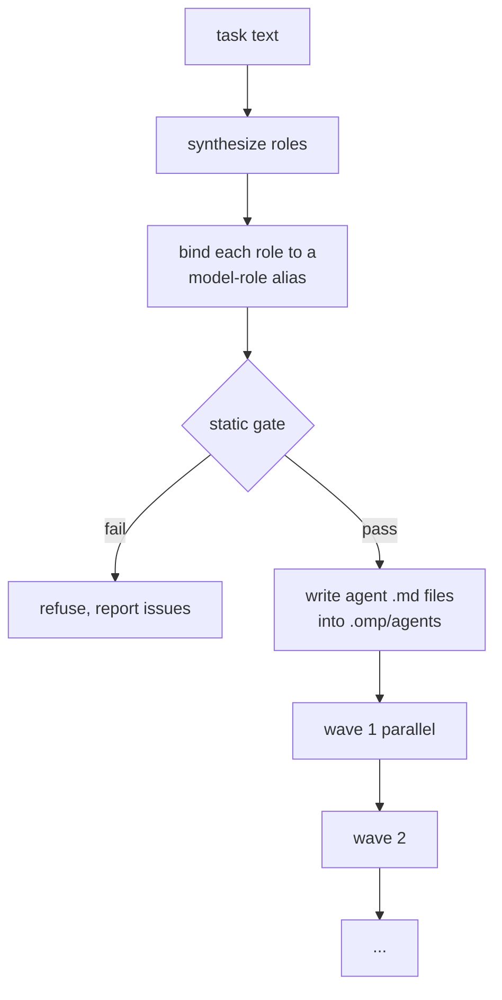

# omp-role-fleet

**One task in. A team of specialised agents out.** Give oh-my-pi a piece of work
and this plugin decides who should do what, gives each of them their own model,
runs them in waves, and hands the result back to the main model.

<https://github.com/supa-magic/omp-role-fleet>

```
you:   refactor the auth module across several files and review it
plugin: scout → planner → implementer → tester → reviewer
        each one runs on the model that suits it, in dependency order
```

No config file, no roster to maintain, no `agents/*.md` to hand-write. The
plugin writes those agent definitions for you, per run, and prunes the previous
run's on the next one.

---

## Install

```sh
omp plugin install @supa-magic/omp-role-fleet
```

Then **start a new session**. Extension modules load at session start and
`/reload-plugins` does not rebuild them, so a running session never picks up
freshly installed plugin code. Check that it took with:

```sh
omp plugin list          # is it enabled?
/role-fleet --version    # which version is loaded?
```

Working from a checkout instead? Link it — a local path is symlinked, not
copied, so your edits are live:

```sh
omp plugin link ./omp-role-fleet
```

**Requires:** oh-my-pi 18.10 or newer. The plugin ships as TypeScript and the
host loads it as-is — no build step, no runtime dependencies. Node 22.6+ is
only needed to run the test suite from a checkout.

---

## Your first run

Try it on something harmless first, with `--dry-run`, which plans without
writing anything:

```text
/role-fleet refactor the auth module across several files and review it --dry-run
```

You get back a plan — who would work on it, in which wave, on which model — and
nothing is written to disk. Drop `--dry-run` when the plan looks right.

From then on it is one command:

```text
/role-fleet fix the login bug
```

The roles run as real background agents. Press `Alt+A` for the Agent Hub to watch
them: each agent shows its resolved model, status, and token usage as it works.

---

## Flags

| Flag | What it does |
|---|---|
| `--dry-run`, `-n` | Plan only. Writes nothing. |
| `--council [N]` | Replace the single reviewer with N reviewers on different models. |
| `--max-roles N` | Cap on generated roles (default 4, hard max 8). |
| `--allowlist FILE` | Pin models to a file instead of using `@` aliases. A leading `~` is expanded. |
| `--specialist` | Force an extra model call to propose extra specialist roles. |

Two of these are worth explaining, because they change the rules rather than the
details.

**`--allowlist FILE`** — by default each role takes a *model-role alias*
(`@smol`, `@plan`, `@task`, `@slow`, `@vision`), and which concrete model stands
behind `@slow` is decided by your `modelRoles` in `/model`. An allowlist replaces
that indirection with an explicit list. Reach for it when you have a compliance
requirement, when one specific model is clearly better for a class of work, or
when you want to pin the fleet once and not think about it again:

```json
{
  "models": [
    { "selector": "anthropic/claude-haiku-4-5", "aliases": ["haiku"] },
    { "selector": "anthropic/claude-sonnet-4-6", "aliases": ["sonnet"] }
  ],
  "roles": [
    { "role": "scout", "chain": ["haiku"] },
    { "role": "implementer", "chain": ["sonnet"] }
  ]
}
```

That is the whole schema. `models` name concrete selectors (add `"enabled": false`
to bench one); `roles` name a seat and the chain of models it may take, in
preference order. Binding is **ordinal per seat**: the second reviewer in a
council takes the second model in that seat's chain, not the first — otherwise
"review with different providers" would quietly become three copies of one model.

A seat the file describes is pinned. A seat it does not describe keeps its `@`
alias and the plan records a note saying so — the file constrains the seats it
lists, it is not a blanket guarantee that no unlisted model can run.

Set it once instead of passing the flag every time:

```sh
export ROLE_FLEET_ALLOWLIST=~/my-fleet.json
```

**`--specialist`** — the usual cast is chosen by static heuristics on your task
text. When a task is unusual enough that the standard seats are clearly the wrong
workers, this flag lets one cheap model call propose up to three additional roles.
The proposal is sandboxed: it can only pick models and tools from fixed allowlists,
cannot claim a reserved seat, and **one invalid element discards the whole
proposal** rather than half-applying it. Any failure silently keeps the static
cast. Without the flag the plugin still does this on its own when the static cast
looks thin, or when your task text contains "specialist", "expert", or
"consultant".

The proposal needs an ephemeral side turn. On a host that does not provide one
the tier is simply absent — `--specialist` then does nothing, quietly, and the
static cast runs as usual.

---

## Review council

```text
/role-fleet fix the auth bug --council
```

Or just say it — "view with different providers", "multi-model review" — and the
council triggers on the wording.

The single reviewer is replaced by N reviewers on **distinct models**, reviewing
the same change in one parallel wave, none of them seeing the others' reports.
That independence is the point: three reviewers on the same model tend to repeat
the same blind spot three times.

When the reports come back, the dispatch prompt requires the main model to read
every one of them, state explicitly where they agree and where they disagree, and
adopt the **most conservative** finding as the verdict — a risk one reviewer saw
is a risk, even if the other two missed it.

Two details that surprise people: the council ignores `--max-roles`, because
dropping reviewers to fit a budget would silently undo the review you asked for
(the plan says so in a note when the exempt roles push the real count past the
cap); and on analysis-only tasks its members join after the scout rather than
replacing a reviewer that was never going to exist.

---

## What actually happens



1. **Synthesize** — the shape of the task decides the cast: investigation,
   planning (multi-file work only), implementation, tests, review, docs. A role
   cap (default 4) bounds the fan-out; when it bites, the implementer is the last
   role dropped.
2. **Bind** — each role takes an alias: recon and test runs ride `@smol`
   (mechanical work), planning rides `@plan`, implementation rides `@task` — the
   planner already did the heavy thinking, and an executor of a locked plan does
   not need a premium seat — while review and security ride `@slow`. Retargeting a
   whole class of work is one step in `/model`.
3. **Gate** — static validation of dependencies, acceptance criteria and artifacts
   (in allowlist mode, the model too). A plan that does not hold up is refused
   before any money is spent.
4. **Emit** — one omp agent per role, prefixed `rf-`, with `tools`, `model` and
   `thinking-level` pinned. The prefix is not cosmetic: omp resolves agents by
   name, and a project `scout.md` would otherwise silently replace the bundled
   scout with this run's mission. Files land flat in `<repo>/.omp/agents/` (omp
   scans `agents/*.md` at the top level only). The previous run's generated files
   are pruned; hand-written agents are never touched; and task text never reaches
   the frontmatter — only the markdown body, so a task containing `---` cannot
   break the definition.
5. **Dispatch** — the roles of one wave go out as a single parallel `task` batch;
   the next wave waits for the previous one. Each batch item carries a readable
   roster `name` (role + alias) instead of omp's random `AdjectiveNoun` defaults.

---

## Specialist seats

Beyond the base cast, two tiers cover shapes where a generic seat is the wrong
worker.

**Library** — deterministic, zero model calls. A `designer` joins UI work; a
read-only `security-auditor` joins security wording on `@slow`; a
`migration-runner` **replaces** the implementer for migrations, because a
migration is implementation and two writers on the same files is a defect, not a
feature. Audit-shaped tasks without build verbs drop the implementer and the
tester, so the auditor is never squeezed out by the role cap. On a task that
*does* carry a build verb — "fix the injection bug" — the base cast already
fills the cap and the auditor is the one dropped, with a note saying so; raise
`--max-roles` to seat it.

> The designer seat is pinned to `@designer`, which is **not** a stock omp role.
> Add a `modelRoles.designer` entry in `/model`, or that seat falls back to
> whatever model your session is already using.

**Generated** — dynamic and validated. When the static cast is clearly thin for
the task, one cheap ephemeral model call proposes up to three specialist roles as
JSON. A proposal can never invent a model (aliases only), a tool outside the grant
list, a dependency that does not resolve, or a role count past the cap; one
invalid element discards the whole proposal, and any failure keeps the static
cast silently.

---

## The advisor

oh-my-pi exposes no advisor API to extensions at all. The one touchpoint is the
advisor's own `advise` tool calls, which arrive on `tool_call` with the identity
`{kind:"sub", id:"advisor"}`. The plugin records those notes and shows them via
`/role-fleet-advisor`; a blocker escalates immediately.

The role-set decision is made before any money is spent — that is the static gate
— and omp's own advisor reviews the dispatch itself once the main model starts
running it.

---

## Safety notes

- **No secrets.** The package has zero runtime dependencies and the only host
  import is type-only, so nothing from your environment is pulled in.
- **Writes are scoped.** Generated agents land in `<repo>/.omp/agents/rf-*.md`.
  Each run also pre-creates its own artifact directory
  `<repo>/.role-fleet/run-<id>/`, so a worker never inherits a missing parent.
  That tree is bounded: the newest **10** run directories are kept and older ones
  deleted on the next run — by count, not by age, since count is what bounds the
  damage. Nothing outside `.role-fleet/` and `.omp/agents/` is touched, and
  anything the plugin did not name it will not delete: prune removes only
  `run-<digits>` directories, and never the current run or one newer than it —
  a newer id belongs to a run still in flight, so a burst of concurrent runs
  cannot delete an in-flight run's artifacts. Pruning of agent files likewise
  only ever deletes files carrying this plugin's own generated marker *and*
  whose frontmatter name matches their filename.
- **Prune-safe.** A hand-written `agent.md`, or a generated one you renamed, is
  never deleted.
- **`role_fleet_plan` is `approval: "write"`**, because it does write files. Under
  a read-only tool policy the host will prompt you.

---

## Development

```sh
npm install
npm test          # no provider, no session, no credentials needed
npm run typecheck
```

Before publishing, `npm pack --dry-run` should list exactly `package.json`,
`README.md`, `LICENSE` and `src/**` — nothing else.

## License

MIT