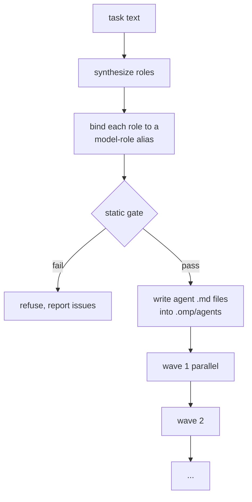

# omp-role-fleet

Split a task into agent roles and dispatch them in parallel waves.

<https://github.com/supa-magic/omp-role-fleet>

```
task → scout → planner (multi-file only) → implementer → tester/reviewer
     → each role becomes a real omp agent with its own model
     → waves: roles inside a wave run in parallel, waves run in order
```

**Zero configuration.** Each role's model is an omp model-role alias
(`@smol`, `@plan`, `@task`, `@slow`, `@vision`) that the host resolves through
your `modelRoles`. Which concrete model stands behind `@slow` is your decision in
`/model`, the way every omp user already knows. When you do need pinned models,
pass an allowlist file.

## Install

```sh
omp plugin install omp-role-fleet        # from the npm registry
```

From a checkout, link it instead — a local path is symlinked, not copied:

```sh
omp plugin link ./omp-role-fleet
```

Check what is enabled with `omp plugin list`, then start a new session: extension
modules load at session start, and `/reload-plugins` does not rebuild them, so a
running session never picks up freshly installed plugin code.

Requires omp 18.10+ — the plugin ships as TypeScript and the host loads it
as-is, with no build step and no runtime dependencies. Node 22.6+ is only needed
to run the test suite from a checkout.

## Use

```text
/role-fleet refactor the auth module across several files and review it
/role-fleet fix the login bug --dry-run
/role-fleet fix the auth bug and review it --council
/role-fleet view with different providers          # council wording auto-triggers
/role-fleet audit the api for injection            # specialist seats join
```

`/role-fleet --version` prints the loaded plugin version — the quickest way to tell
a fresh install from a stale session.

The `role_fleet_plan` tool is available to the model itself — it can request a
plan through an ordinary call.

## What happens



1. **Synthesize** — the shape of the task decides the cast: investigation,
   planning (multi-file work only), implementation, tests, review, docs. A role
   cap (default 4) bounds fan-out; when it bites, the implementer is the last
   role dropped.
2. **Bind** — each role takes an alias: recon and test runs ride `@smol`
   (mechanical work), planning rides `@plan`, implementation rides `@task` — the
   planner already did the heavy thinking, and an executor of a locked plan does
   not need a premium seat — while review and security ride `@slow`. Retargeting
   a whole class of work is one step in `/model`.
3. **Gate** — static validation (dependencies, acceptance, artifacts; in
   allowlist mode, the model too). omp's own advisor reviews the dispatch once
   the main model starts running it.
4. **Emit** — one omp agent per role, prefixed `rf-`, with `tools`, `model`, and
   `thinking-level` pinned. The prefix is not cosmetic: omp resolves agents by
   name, and a project `scout.md` would silently replace the bundled scout with
   this run's mission. Files land flat in `<repo>/.omp/agents/` (omp scans
   `agents/*.md` at the top level only); the previous run's generated files are
   pruned, hand-written agents are never touched, and task text never reaches
   the frontmatter — only the body.
5. **Dispatch** — the roles of one wave go out as a single parallel `task`
   batch; the next wave waits for the previous one. Each batch item carries a
   roster `name` (role + alias), so running agents are readable instead of omp's
   random AdjectiveNoun defaults; the Agent Hub (`Alt+A`) shows each agent's
   resolved model, status, and usage.

## Specialist seats

Beyond the base cast, two tiers cover shapes where a generic seat is the wrong
worker:

- **Library** (deterministic, zero model calls): a `designer` joins UI work on
  `@designer` (not a stock omp role — add a `modelRoles.designer` entry, or the
  seat falls back to your session model); a read-only `security-auditor` joins
  security wording on `@slow`;
  a `migration-runner` **replaces** the implementer for migrations — a migration
  is implementation, and two writers on the same files is a defect, not a
  feature. Audit-shaped tasks without build verbs drop the implementer and
  tester so the auditor is never squeezed out by the role cap.
- **Generated** (dynamic, validated): when the static cast is clearly thin for a
  task, one cheap ephemeral model call proposes up to three specialist roles as
  JSON. A proposal can never invent a model (aliases only), a tool outside the
  grant list, a dependency that does not resolve, or a role count past the cap;
  one invalid element discards the whole proposal, and any failure keeps the
  static cast silently.

## Review council

```text
/role-fleet fix the auth bug --council        # or say "different providers"
```

The single reviewer is replaced by N reviewers on distinct aliases — in a normal
setup, distinct providers — reviewing the same change in one parallel wave, none
of them seeing the others' reports. The dispatch prompt then requires the main
model to read every review, surface agreements and disagreements explicitly, and
adopt the most conservative finding as the verdict: a risk one reviewer saw is a
risk, even if the others missed it. On analysis-only tasks the council does not
wait for a reviewer that will never exist — its members join after the scout.

The council is exempt from the role cap: `--max-roles 2 --council` still yields
the scout plus the full council, because dropping reviewers to fit a budget
would silently undo the review the user asked for.

## The allowlist exception

Pinning models is an exception, not the rule. One flag:

```sh
/role-fleet <task> --allowlist ~/my-fleet.json
# or permanently: export ROLE_FLEET_ALLOWLIST=~/my-fleet.json
```

```json
{
  "models": [
    { "selector": "anthropic/claude-haiku-4-5", "aliases": ["haiku"] },
    { "selector": "anthropic/claude-sonnet-4-6", "aliases": ["sonnet"] }
  ],
  "roles": [
    { "role": "scout", "chain": ["haiku"] },
    { "role": "implementer", "chain": ["sonnet"] }
  ]
}
```

That is the whole schema: `models` name concrete selectors (with optional
`aliases`, and `enabled: false` to bench one), `roles` name a seat and the
chain of models it may take, in preference order.

A seat the file describes takes its model from the seat's chain (the first
enabled entry). A seat the file does not describe keeps its `@` alias and records
a note saying so — the allowlist constrains the seats it lists; it is not a
blanket guarantee that no unlisted model can run.

## The advisor

oh-my-pi exposes no advisor API to extensions at all. The one touchpoint is the
advisor's own `advise` tool calls, which arrive on `tool_call` with the identity
`{kind:"sub", id:"advisor"}`. The plugin records those notes and shows them via
`/role-fleet-advisor`; a blocker escalates immediately. The role-set decision is
made before any money is spent (the static gate), and omp's own advisor reviews
the dispatch itself.

## Development

```sh
npm test
npm run typecheck
```

The tests need no provider, no session, and no credentials.

Before publishing, `npm pack --dry-run` should list exactly `package.json`,
`README.md`, `LICENSE`, and `src/**` — nothing else.

## License

MIT